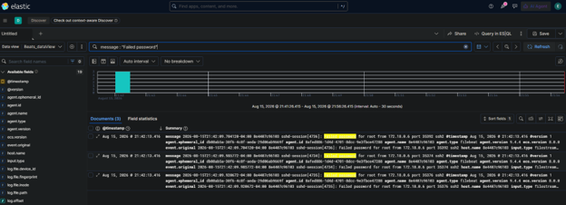
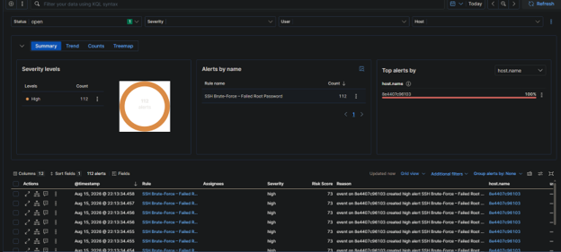

Detecting failed SSH logins with Elastic Stack

## What I built

I set up a Docker-based ELK SIEM to collect Linux authentication logs and detect failed SSH logins. Filebeat collected the logs, Logstash processed them, and Elasticsearch indexed them so I could search them in Kibana.
I verified the failed login events in Kibana Discover, then built a custom detection rule and confirmed it generated alerts during a controlled lab test. The first screenshot shows the failed login events in Discover. The second shows the alerts generated by the rule.

